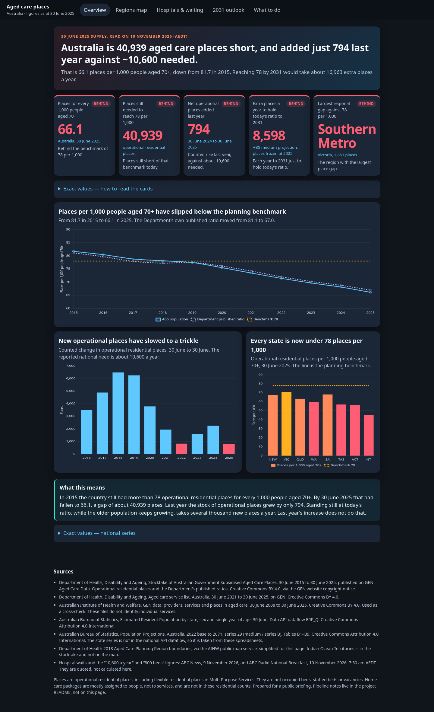
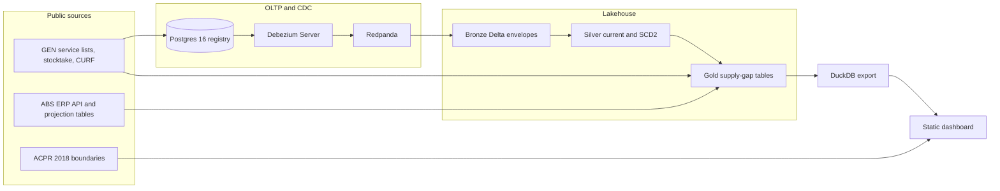

# Aged care bed block

**Where is residential aged care supply falling furthest behind the population aged 70 and over, how fast is that gap growing, and how many extra places a year would each state and planning region need?**

Live dashboard: [https://luciferdataengineer.github.io/aged-care-bed-block/](https://luciferdataengineer.github.io/aged-care-bed-block/)



At 30 June 2025 Australia had **228,259** operational residential places. On the ABS estimated resident population that is **66.1 places per 1,000 people aged 70+**, down from **81.7 in 2015**. The gap against a planning benchmark of 78 has swung from a surplus of about 9,000 places to a shortfall of **40,939**. Last year the stocktake added **794** operational places. States, quoted by the ABC, say about **10,600** a year are needed.

This is daily portfolio project 11. The numbers above are computed from the Department of Health stocktake and the ABS population. The hospital queue (more than 500 older patients in South Australian public hospitals, up from about 60) is quoted from the ABC and is not calculated here. The plain-English version is [INSIGHTS.md](INSIGHTS.md). The stakeholder pages do not mention the pipeline.

## What this project does

It answers a planning question with public data, and it does the data engineering the question needs:

1. A Postgres 16 service registry, loaded from the real GEN aged care service lists for 30 June 2021 to 30 June 2025. Each later year is applied as inserts, updates and deletes.
2. Debezium Server reads the Postgres write-ahead log and publishes the changes to Redpanda.
3. PySpark Structured Streaming (`availableNow`) writes the raw envelopes to a Delta Lake bronze table, then `MERGE`s them into a current-state silver table and an SCD2 history table.
4. Gold tables hold the regional supply-gap marts. DuckDB and the static dashboard read those outputs. The site is rebuilt from the committed gold files, with no live database and no network.
5. YAML data contracts, OpenLineage events, and a measured comparison of a full reload against the CDC merge.

The April 2025 GEN CURF URL in the original brief now returns 404. The same series lives at the May 2026 providers CURF page and runs from 30 June 2008 to 30 June 2025. That is the file this repo uses.

## Architecture



The supply-gap ratios are calculated from the stocktake and the ABS population, not from the change feed. The change feed is the service registry. At 30 June 2025 the residential places on that registry sum to the same **228,259** as the stocktake, which is the check that the two sources describe the same stock.

## Tech stack

| Piece | Choice | Why |
| --- | --- | --- |
| OLTP | Postgres 16 in Docker | The service registry has to be a real database with a write-ahead log. Analytics does not need a hosted database. |
| CDC | Debezium Server 2.7 | Reads `pgoutput` and writes JSON change events. Lighter than a full Kafka Connect cluster. |
| Log | Redpanda 24.2 | Kafka API, one container, no ZooKeeper. |
| Stream processing | PySpark 3.5, `local[2]`, Structured Streaming `availableNow` | Consumes the topic in CI without a cluster. |
| Table format | Delta Lake 3.2 | `MERGE` for the current service row, plus an SCD2 history table. |
| Supply-gap maths | Python, tested in pytest | One implementation of the ratios, shortfalls and 2031 arithmetic. Spark publishes those marts into Delta. |
| Dashboard query | DuckDB reads the gold Parquet | The static site does not need Spark. |
| Contracts | YAML + JSON Schema | Checked in CI on the gold rows and on a CDC envelope. |
| Lineage | openlineage-python file transport | Events in `docs/lineage/events.jsonl`, graph at `docs/lineage/index.html`. |
| Map | Local simplified GeoJSON, inline SVG | No tile server. |
| Charts | Chart.js 4.4.6, vendored | No runtime CDN dependency. |

## What’s new compared with jobs-risk-radar

Project 10 was a batch feature store and a walk-forward model: Polars, dbt-duckdb, Dagster, Feast, LightGBM, MLflow, Evidently, a kind Job, and Terraform. This project does not repeat that stack.

What is new, and running:

- An operational Postgres registry, with each 30 June service list replayed as row changes.
- Debezium streaming those changes into Redpanda. A captured event for Braidwood Multi-Purpose Service is a real insert from the 2021 list, not a fixture.
- Spark Structured Streaming into Delta bronze, then `MERGE` into silver and an SCD2 table. The merged table has **5,378** current services and **228,259** residential places, the same total as the stocktake.
- Data contracts and OpenLineage events emitted by the jobs.
- A wall-clock and rows-touched comparison of full reload versus the CDC merge, in [docs/benchmarks.json](docs/benchmarks.json).

Terraform still validates a small description of the local stack (`infra/terraform`). A kind cluster is not in this repo. Compose already runs the services the pipeline needs, and a second cluster would not test a different path.

## Data sources

All of these are free, with no account and no API key. The committed copies are in `data/snapshot/`. Hashes, byte sizes, row counts and the licence wording are in [data/snapshot/manifest.json](data/snapshot/manifest.json). Access date: **10 November 2026 (AEDT)**.

| Publisher | What | Page | Licence | Coverage |
| --- | --- | --- | --- | --- |
| Department of Health, Disability and Ageing, via GEN | Stocktake operational places and ratios by state, 30 June 2015–2025, and by Aged Care Planning Region at 30 June 2025 | [Stocktake 30 June 2025](https://www.gen-agedcaredata.gov.au/resources/access-data/2025/october/stocktake-data-30-june-2025) | CC BY 4.0, as stated on the [GEN copyright page](https://www.gen-agedcaredata.gov.au/copyright) | States 2015–2025; 73 regions in 2025 |
| Department of Health, via GEN | Aged care service list, Australia | [30 June 2025](https://www.gen-agedcaredata.gov.au/resources/access-data/2025/october/aged-care-service-list-30-june-2025) and the 2021–2024 editions | CC BY 4.0. data.gov.au also lists the service list as Creative Commons Attribution 4.0 International | Service-level places, provider, region, latitude and longitude |
| AIHW GEN | Providers, services and places CURF | [May 2026 CURF page](https://www.gen-agedcaredata.gov.au/resources/access-data/2026/may/gen-data-providers-of-aged-care) (the April 2025 URL 404s) | CC BY 4.0 | Confidentialised service rows, 2008–2025. No service id |
| ABS | Estimated resident population, persons, single year of age, 30 June, dataflow `ERP_Q` | [Data API](https://data.api.abs.gov.au/rest/data/ABS,ERP_Q,1.0.0) | CC BY 4.0, [ABS copyright](https://www.abs.gov.au/copyright) | Ages 70–100, states and Australia, June 2014–2025 |
| ABS | Population projections, series 29 (medium / series B), Tables B1–B9 | [2022 base – 2071](https://www.abs.gov.au/statistics/people/population/population-projections-australia/latest-release) | CC BY 4.0 | The API dataflow `POP_PROJ` returned Australia only. State keys 404. States come from the published workbooks |
| Department of Health, via the AIHW map service | 2018 Aged Care Planning Regions | [Feature service](https://maps.arcgis.aihw.gov.au/server/rest/services/Hosted/Aged_Care_Planning_Regions_2018/FeatureServer) | No separate licence string on the service. AIHW downloads are CC BY 4.0 unless a file says otherwise. Simplified locally | 72 polygons. Indian Ocean Territories is in the stocktake and not on the map |
| ABC | Hospital waits, the 10,600 and the 800 | [ABC News, 9 November 2026](https://www.abc.net.au/news/2026-11-09/residential-aged-care-bed-waitlist-south-australia-families/107341030), [RN Breakfast, 10 November 2026, 7:30 am AEDT](https://www.abc.net.au/listen/programs/radionational-breakfast/radio-national-breakfast-sa-premier-aged-care/107366264) | Quoted, not redistributed | Reported figures only |

`make refresh` re-downloads every URL in `src/agedcare/refresh.py` and rewrites the manifest. CI does not call it.

## Cleaning

- Stocktake workbooks are read from the “As at 30 June” blocks. State total rows are dropped so a state is not also counted as a region. The Australia total is kept as its own row.
- Blank, dash and en-dash place cells stay missing. They are not filled with zero. Residential place totals use zero only when a service-list cell is blank and a sum is required, and that sum matches the stocktake (228,259).
- Service identity is a hash of state, care type, normalised name and suburb. The national workbooks do not publish a stable service number. Address text is not part of the identity and is not a reason to emit an update: the 2024 and 2025 files format the address column differently, and a raw compare marks every matched service as changed.
- Aged Care Planning Region names are matched to the map with punctuation and “and” normalised. 72 of 73 stocktake regions match. Indian Ocean Territories (0 places) does not have a polygon.
- ABS June population is the Q2 observation. Ages 70 through 100 are summed. The extract has no separate “100 and over” row beyond age 100; any people older than 100 who are not in that code are a small miss relative to 3.45 million people aged 70+.
- Projection tables contribute persons, series 29 (B), ages 70 and over, including “100 and over”.

## Data model

**Postgres `registry`**

- `providers` — one row per provider name.
- `services` — the current service: places, region, provider, and `source_year` of the last material change.
- `places_by_year` — one row per service per 30 June. Deletes of a service do not remove this history.

**CDC envelope** (Debezium JSON, schemas disabled): `op` (`c`, `u`, `d`, `r`), `before`, `after`, `source.table`, `ts_ms`. Contract: [data/contracts/cdc_envelope.schema.yaml](data/contracts/cdc_envelope.schema.yaml).

**Bronze** `data/lakehouse/bronze/cdc` — the Kafka record: topic, offset, key, and the raw envelope. The measured run wrote **63,726** envelopes.

**Silver**

- `services_current` — latest event per `service_id`, `MERGE`d. Deletes remove the row. **5,378** services, **228,259** residential places.
- `services_scd2` — one version per non-delete event, with `valid_from_ts` and `valid_to_ts`. **24,528** versions.

**Gold**

- `supply_gap_state` — operational places, ABS population 70+ and 80+, places per 1,000, Department published ratio, net change, shortfall against 78. States and Australia, 2015–2025.
- `supply_gap_acpr` — 30 June 2025 regions, published ratio, implied Department population, shortfall against 78, and an estimated 80+ ratio.
- `outlook_2031` — extra places to hold today’s ratio, and to reach 78, by 30 June 2031.
- `listed_places_by_state` — Spark aggregate of the CDC current table.

DuckDB reads the Parquet copies in `data/gold/` for the dashboard. Example:

```sql
SELECT state_code, per_1000_70, shortfall_vs_78
FROM 'data/gold/supply_gap_state.parquet'
WHERE year = 2025
ORDER BY shortfall_vs_78 DESC;
```

## Key insights

The full write-up is [INSIGHTS.md](INSIGHTS.md). The headlines:

- **66.1** operational residential places per 1,000 people aged 70+ at 30 June 2025 (ABS). The Department’s published ratio, on a population projection based on the 2017 ERP, is **67.0**.
- The ratio was **81.7** in 2015. The shortfall against 78 grew by **49,854** places over the decade (from a surplus of about 9,000 to a shortfall of **40,939**).
- Net new operational places fell from several thousand a year in the late 2010s to **794** in 2024–25. That matches the “about 800” reported by the ABC. It is not close to 10,600.
- Largest place gaps against 78, on the ABS population: **New South Wales 11,736**, **Queensland 10,292**, **Western Australia 6,441**. Thinnest state ratios: **Northern Territory 45.4**, **ACT 56.1**, **Tasmania 56.9**.
- Largest regional place gap: **Southern Metro (Victoria), 1,853 places**, ratio 69.0. Lowest ratio with any places: **Darwin, 34.7**.
- South Australia fell from **91.1** per 1,000 in 2015 to **68.1** in 2025. Places only rose from 18,390 to 19,175. The state reports more than 500 older patients waiting in hospital for a residential place, up from about 60. This project does not calculate that queue.
- To **hold** today’s national ratio to 2031, on the ABS medium projection and with no closures, needs about **8,598** extra places a year (**51,585** in total). To **reach 78** by 2031 needs about **16,963** a year. The states’ 10,600 would hold today’s ratio and close a little of the gap. It would not restore 78. A reported federal construction claim of about 5,000 beds a year would slow the slide and would not stop it.

Per 1,000 people aged 80+ the national figure is about **183**. That is not a target. The 80+ population is smaller, so the same places produce a higher ratio. The 78 benchmark applies to people aged 70+.

## Benchmarks and cost

Measured on this machine with Spark `local[2]`, Java 17, after a real Debezium run. Not a cloud cluster. Numbers are in [docs/benchmarks.json](docs/benchmarks.json).

| Path | Wall time | Rows touched | Files written |
| --- | --- | --- | --- |
| CDC stream into bronze | 8.2 s | 63,726 envelopes | 3 Parquet files |
| `MERGE` of the latest event per service | 4.4 s | 7,554 keys | 4 files in the current table |
| SCD2 history | 0.6 s | 24,528 versions | 2 files |
| Full reload, overwrite the current table once per year, 2021–2025 | 7.4 s | 27,605 service-year rows | 5 files |

On this extract the full overwrite is faster in wall clock. It does not parse JSON envelopes. It does rewrite every service in every year. The merge writes one current row per service that has ever appeared. A second streaming run uses the Delta checkpoint and reads only new offsets. The Postgres replay itself touched **50,439** rows (providers, service inserts, updates, deletes, and place-year inserts): see `data/gold/replay_stats.json`.

**Indicative cloud arithmetic, not a bill and not a quote.** Nothing was spent.

- A 2-vCPU Spark job at an illustrative USD 0.10 per vCPU-hour costs well under one US cent for either path at these runtimes. The difference is noise.
- The cost that is not noise is an always-on change feed: a small Postgres instance is on the order of USD 15–30 a month, and a small Kafka-compatible broker on the order of USD 40–80 a month, using rough public list prices in 2026. A nightly batch reload of this registry does not need that standing cost.
- Object storage for these Delta tables is megabytes. At about USD 0.02 per GB-month it does not matter.
- CDC pays off when the registry is large and most rows do not change. Here, place-year history is appended for every service every year (27,605 inserts). The service-row changes are the smaller set: a few hundred material updates a year once address-format noise is ignored. For a daily job, checkpointed merge of that day’s changes is the cheaper Spark path. For this historical backfill, the batch overwrite is simpler and, on the clock, quicker.

## How to run

Requirements: Python 3.12, Java 17, Docker with Compose. `JAVA_HOME` defaults to `/usr/lib/jvm/java-17-openjdk-amd64`.

```bash
make setup          # pip install
make dashboard      # rebuild gold figures and the static site in site/
make up             # Postgres, Redpanda, Debezium, and wait until streaming
make cdc            # replay 2021–2025 into Postgres; Debezium publishes the changes
make lakehouse      # Spark bronze, MERGE, SCD2, gold Delta, benchmarks
make test           # pytest unit tests
make lint           # ruff
make bench          # same Spark job; writes docs/benchmarks.json
make refresh        # re-download the public files and rewrite the manifest
make down           # stop the stack and delete volumes
```

The Compose file uses host networking so Postgres, Redpanda and Debezium share `127.0.0.1`. That is what worked on this Linux environment, where container-to-container bridge traffic timed out, and it is the same network mode CI uses. Spark reads `127.0.0.1:9092`.

Open `site/index.html` after `make dashboard`, or serve the directory. Screenshots are regenerated with `PYTHONPATH=src python -m agedcare.screenshots` (Playwright and Chromium).

## Testing and CI

Local, on this commit:

- `pytest tests/unit` — 7 tests, including the stocktake total of 228,259, the 66.1 ratio, the 794 net change, the 2031 pace relative to 10,600, and the gold contract.
- `pytest tests/integration` — the merged Delta table matches the 2025 service ids and the 228,259 place total, a sample event matches the CDC contract, and SCD2 is at least as long as the current table.
- `ruff check src tests`.

GitHub Actions (`.github/workflows/ci.yml`) runs lint and unit tests, the Compose CDC job through the Spark merge and the integration test, and `terraform validate`. Pages (`.github/workflows/pages.yml`) builds `site/` from the committed gold files on push to `main` and deploys with `actions/upload-pages-artifact` and `actions/deploy-pages`. Pages is already enabled for this repository. The workflow does not try to enable it.

## Lineage and contracts

OpenLineage events are appended to [docs/lineage/events.jsonl](docs/lineage/events.jsonl) by the marts build, the Postgres replay and the Spark job. [docs/lineage/index.html](docs/lineage/index.html) draws the inputs and outputs. The stakeholder site does not link to it.

Contracts:

- [data/contracts/cdc_envelope.schema.yaml](data/contracts/cdc_envelope.schema.yaml)
- [data/contracts/gold_supply_gap_state.schema.yaml](data/contracts/gold_supply_gap_state.schema.yaml)

`python -m agedcare.contracts` checks the gold Parquet against the schema.

## Limitations

- **Places are not beds in use.** Operational places include flexible residential places in Multi-Purpose Services, the Innovative Pool and the National Aboriginal and Torres Strait Islander Flexible Aged Care Program. They are not occupied beds, staffed beds or vacancies. A region can look supplied and have no bed free this week.
- **Home care is out of the residential ratio.** Since February 2017 most home care places are assigned to people, not services. The stocktake’s home care column is only the flexible home care places in programs such as Multi-Purpose Services. It is not the Home Care Packages program.
- **Planning regions are not an ABS geography.** The 2025 regional population is the Department’s own June 2025 figure, recovered as places divided by the published ratio. The stocktake says that population is a customised projection based on the 2017 ERP. The 80+ ratio for a region applies the state’s ABS share of people aged 80+ within the 70+ population. The 2031 regional population keeps each region’s 2025 share of its state and grows it with the state’s medium-series 70+ growth. Regions that age faster than their state are not observed separately.
- **The 2031 figures are a projection, not a forecast.** They use ABS series 29, the medium series (series B), 2022 base. Growth between the projection’s 2025 and 2031 is applied to the 2025 estimated resident population. No allowance is made for places already funded but not yet operational, or for closures. “Extra places” assumes today’s stock stays open.
- **78 is a yardstick.** It is the residential component of the long-standing Commonwealth target provision ratio (78 residential, 2 restorative, 45 home care, totalling 125 per 1,000 people aged 70+). It is not a count of people who need a bed, and governments no longer treat the old ratio as an entitlement. The “hold today’s ratio” numbers do not depend on 78.
- **Hospital waits are reported, not computed.** “More than 500” older patients in South Australian public hospitals, “about 60” four years earlier, “10,600” places a year, “800” beds added last year, and “about 5,000” beds in the federal construction claim are taken from ABC News on 9 November 2026 and ABC RN Breakfast on 10 November 2026. The stocktake’s own net change is 794, which is the counted figure next to the reported 800.
- **Service open and close counts are an upper bound.** Without a stable service number, a renamed home or a respelt suburb looks like a closure plus an opening. Place totals do not depend on that match. The 30 June 2025 service-list residential places sum to the stocktake total exactly.
- **The CURF is not a registry.** It has no service identifier. Summing rows labelled residential care in 2025 gives 224,493 places, short of 228,259, because flexible residential places sit under other program names in the CURF. It is a cross-check, not the supply series.
- **The national API projection dataflow did not return states.** `POP_PROJ` answered for Australia and returned no records for state keys. State projections are the published Table B1–B8 workbooks from the same release.

## Licence and attribution

Code in this repository is MIT. See [LICENSE](LICENSE).

Data keeps the publisher’s licence, recorded in [data/snapshot/manifest.json](data/snapshot/manifest.json):

- GEN and the Department of Health files published there: Creative Commons BY 4.0. Source: “Material that can be copied or downloaded from this website has been released under a Creative Commons BY 4.0 (CC-BY 4.0) licence.” [GEN copyright](https://www.gen-agedcaredata.gov.au/copyright).
- ABS tables and the Data API extract: Creative Commons Attribution 4.0 International. Source: “All material presented on this website is provided under a Creative Commons Attribution 4.0 International licence,” with exceptions that do not cover these tables. [ABS copyright](https://www.abs.gov.au/copyright).
- Chart.js 4.4.6 is vendored under its own MIT licence in `dashboard/vendor/`.

Please attribute the Australian Institute of Health and Welfare, the Department of Health, Disability and Ageing, and the Australian Bureau of Statistics, and do not imply that they endorse this project.
